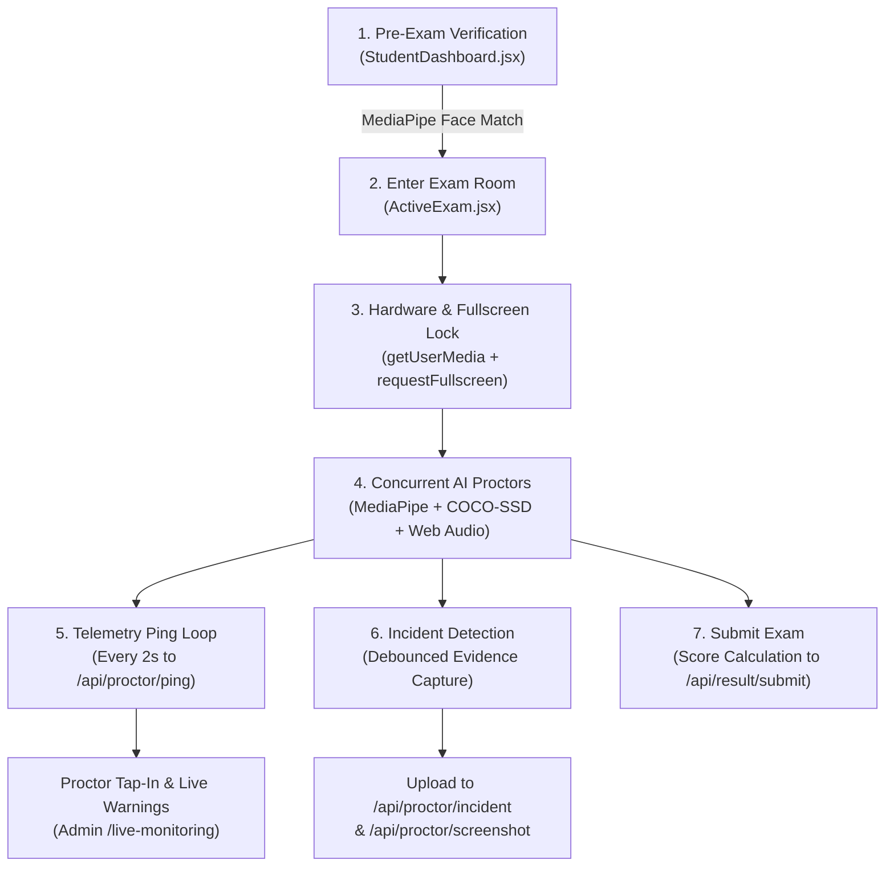

# 🏛️ AI-Invigilator — System Architecture & Reference Guide

This document provides a concise technical summary of the AI-Invigilator codebase, covering directory layouts, proctoring engines, data flow, database schemas, and API endpoints.

---

## 1. High-Level Architecture Overview

The system is a full-stack, AI-proctored online examination platform comprising:
* **Frontend (`/app`)**: React 18 single-page application built with Vite and Tailwind CSS. Runs client-side Computer Vision (MediaPipe + TensorFlow.js) and Web Audio API spectrum analysis via WebGL/GPU acceleration.
* **Backend (`/server`)**: Node.js + Express REST API providing authentication, real-time proctor telemetry, question bank delivery, report compilation, and file storage for evidence.
* **Database**: PostgreSQL hosted on **Supabase Cloud** (with dual-mode fallback resilience and connection pooler on port 5432).

---

## 2. Folder Structure

```
Final year/
├── ARCHITECTURE.md                  # System architecture reference (this file)
├── presentation_viva_guide.md       # Viva exam guide & technical Q&A breakdown
├── AI_Invigilator_Project_Overview.pdf
│
├── app/                             # Frontend React + Vite SPA
│   ├── index.html                   # HTML entry with font preloads
│   ├── package.json                 # Dependencies (MediaPipe, TensorFlow, JSZip, jsPDF)
│   ├── vite.config.js               # Vite bundler configuration
│   ├── tailwind.config.js           # Multi-theme design tokens
│   └── src/
│       ├── main.jsx                 # Application entry point with BrowserRouter
│       ├── App.jsx                  # Client-side routes & ProtectedRoute guards
│       ├── index.css                # Scoped Tailwind CSS & design variables
│       │
│       ├── components/              # Shared UI components
│       │   ├── ProtectedRoute.jsx   # Role-based route guards (Student/Admin)
│       │   ├── ThemeToggle.jsx      # Dark/Light theme switcher
│       │   ├── MoltenMetal.jsx      # Canvas shader animations
│       │   └── admin/
│       │       ├── AdminLayout.jsx  # Common admin page shell
│       │       └── AdminSidebar.jsx # Admin navigation menu
│       │
│       ├── context/
│       │   ├── AuthContext.jsx      # User session state (student & admin tokens)
│       │   └── ThemeContext.jsx     # Dark/Light theme provider
│       │
│       ├── hooks/
│       │   └── useAuth.js           # Custom hook consuming AuthContext
│       │
│       ├── pages/
│       │   ├── LandingPage.jsx      # Public landing page
│       │   ├── StudentLogin.jsx     # Student login with demo credentials
│       │   ├── Register.jsx         # Registration with baseline face capture
│       │   ├── ForgotPassword.jsx   # Email OTP reset request
│       │   ├── VerifyOTP.jsx        # OTP code verification
│       │   ├── ResetPassword.jsx    # New password submission
│       │   ├── StudentDashboard.jsx # Student portal & pre-exam face verification
│       │   ├── ActiveExam.jsx       # Real-time AI proctored exam room
│       │   ├── AdminLogin.jsx       # Administrator portal login
│       │   ├── AdminOverview.jsx    # Executive telemetry summary dashboard
│       │   └── admin/
│       │       ├── LiveMonitoring.jsx     # Real-time candidate surveillance grid
│       │       ├── ExaminationReports.jsx # Gradebook & automated PDF reports
│       │       ├── IntegrityViolations.jsx# Flagged incident ledger & snapshots
│       │       ├── AIExamGenerator.jsx    # PPTX parser & AI question builder
│       │       └── SystemSettings.jsx     # AI threshold parameters
│       │
│       ├── services/
│       │   ├── api.js               # Axios instance (baseURL: http://localhost:5000/api)
│       │   └── authService.js       # Centralized API fetch helpers
│       │
│       └── utils/
│           ├── audioSpeechDetector.js # Web Audio API + FFT whisper/speech engine
│           ├── faceMatcher.js         # MediaPipe 3D face extraction & comparison
│           └── mockMonitoring.js      # Simulation events helper
│
└── server/                          # Backend Node.js + Express REST API
    ├── server.js                    # Express application entry & route mounts
    ├── package.json                 # Dependencies (pg, express, bcrypt, jsonwebtoken)
    ├── .env                         # Environment variables (DB URL, JWT secret, ports)
    ├── .env.example                 # Configuration template
    │
    ├── config/
    │   └── db.js                    # Dual-mode PG pool (Supabase IPv4 Pooler + Fallback)
    │
    ├── controllers/
    │   ├── authController.js        # Student auth, OTP & profile photo upload
    │   ├── adminController.js       # Admin authentication & token generation
    │   ├── examController.js        # Question bank & exam publishing
    │   ├── resultController.js      # Exam score submission & report queries
    │   └── proctorController.js     # Telemetry ping, incidents & dashboard stats
    │
    ├── routes/
    │   ├── authRoutes.js            # /api/auth/* endpoints
    │   ├── adminRoutes.js           # /api/admin/* endpoints
    │   ├── examRoutes.js            # /api/exam/* endpoints
    │   ├── resultRoutes.js          # /api/result/* endpoints
    │   └── proctorRoutes.js         # /api/proctor/* endpoints
    │
    ├── uploads/
    │   ├── incidents/               # Violation photographic evidence (.jpg)
    │   └── snapshots/               # Real-time telemetry webcams & screen shares
    │
    ├── setup_cloud_db.js            # DDL script initializing PostgreSQL schema
    ├── sync_incidents.js            # Batch upload helper for incident archives
    └── sync_local_to_supabase.js    # Data synchronization pipeline
```

---

## 3. How the Exam Room Works

The active exam lifecycle is managed inside [`app/src/pages/ActiveExam.jsx`](file:///c:/Users/PURVA%20NAIK/OneDrive/Desktop/Final%20year/app/src/pages/ActiveExam.jsx):



### Detailed Lifecycle Steps:
1. **Pre-Exam Identity Verification (`StudentDashboard.jsx`)**:
   Before navigating to `/exam`, a verification modal activates the student's camera. [`faceMatcher.js`](file:///c:/Users/PURVA%20NAIK/OneDrive/Desktop/Final%20year/app/src/utils/faceMatcher.js) extracts 468 3D facial landmarks from both the live video and the stored baseline photo (captured at registration) and calculates Euclidean distance. Only if the match succeeds does the exam unlock.
2. **Initialization & Hardware Access**:
   * Requests camera and microphone streams via `navigator.mediaDevices.getUserMedia`.
   * Enforces browser fullscreen via `document.documentElement.requestFullscreen()`.
   * Fetches examination questions from `GET /api/exam/questions/:examId`.
3. **Continuous Vision & Audio Monitoring**:
   * **MediaPipe FaceLandmarker**: Tracks face presence, eye closure (EAR), and head direction (Pitch, Yaw, Roll).
   * **TensorFlow.js COCO-SSD**: Scans every frame for prohibited objects (specifically `cell phone`) and unauthorized persons (`person` count > 1).
   * **AudioSpeechDetector**: Analyzes live audio streams in real-time using FFT to detect speech and high-frequency whisper sibilance.
4. **Browser Event Listeners**:
   * `fullscreenchange`: Alerts and logs `FULLSCREEN_EXIT` if candidate escapes fullscreen.
   * `visibilitychange` & `blur`: Logs `TAB_SWITCH` or `WINDOW_BLUR` if student navigates away.
5. **Real-Time Telemetry Heartbeat (Every 2 seconds)**:
   * Compiles current webcam snapshot and simulated screen viewport canvas to Base64 JPEG.
   * Sends payload to `POST /api/proctor/ping`.
   * Receives incoming warning messages sent by the proctor and displays modal alerts.
6. **Submission**:
   * Calculates score against question answer keys.
   * Submits final tally to `POST /api/result/submit`.
   * Cleans up media tracks, stops AI loops, and presents completion summary.

---

## 4. Where MediaPipe and TensorFlow.js Code Lives

| Technology | Purpose | File Location | Key Functions / Usage |
| :--- | :--- | :--- | :--- |
| **MediaPipe FaceLandmarker** | Registration baseline face verification | [`app/src/utils/faceMatcher.js`](file:///c:/Users/PURVA%20NAIK/OneDrive/Desktop/Final%20year/app/src/utils/faceMatcher.js#L1-L130) | `getFaceLandmarker()`<br/>`extractLandmarksFromImage()`<br/>`extractLandmarksFromVideo()`<br/>`compareFaceLandmarks()` |
| **MediaPipe FaceLandmarker** | Continuous in-exam head pose & eye tracking | [`app/src/pages/ActiveExam.jsx`](file:///c:/Users/PURVA%20NAIK/OneDrive/Desktop/Final%20year/app/src/pages/ActiveExam.jsx#L510-L610) | `FaceLandmarker.createFromOptions()`<br/>`faceLandmarkerRef.current.detectForVideo()`<br/>Eye Aspect Ratio (EAR) & Yaw/Pitch angles |
| **TensorFlow.js & COCO-SSD** | Real-time object & phone detection | [`app/src/pages/ActiveExam.jsx`](file:///c:/Users/PURVA%20NAIK/OneDrive/Desktop/Final%20year/app/src/pages/ActiveExam.jsx#L480-L505) | `cocoSsd.load()`<br/>`modelRef.current.detect(video)`<br/>Filters for predictions matching `'cell phone'` or multiple `'person'` |
| **Web Audio API + FFT** | Multi-modal speech & whisper detection | [`app/src/utils/audioSpeechDetector.js`](file:///c:/Users/PURVA%20NAIK/OneDrive/Desktop/Final%20year/app/src/utils/audioSpeechDetector.js#L1-L150) | `AudioSpeechDetector` class<br/>`BiquadFilterNode` bandpass (120Hz–4.5kHz)<br/>`AnalyserNode.getByteFrequencyData()` |

* **WASM / Model Assets**:
  * MediaPipe WASM: `https://cdn.jsdelivr.net/npm/@mediapipe/tasks-vision@latest/wasm`
  * MediaPipe Task Model: `https://storage.googleapis.com/mediapipe-models/face_landmarker/face_landmarker/float16/latest/face_landmarker.task`
  * COCO-SSD Model: Loaded client-side via `@tensorflow-models/coco-ssd`

---

## 5. How Violations and the Trust Score Are Stored

### A. Dynamic Trust / AI Confidence Score (Client-Side)
Calculated inside [`ActiveExam.jsx`](file:///c:/Users/PURVA%20NAIK/OneDrive/Desktop/Final%20year/app/src/pages/ActiveExam.jsx#L754-L779) on every telemetry cycle:
* **Starting Base Score**: `98%`
* **Deductions**:
  * Phone detected: `-55%`
  * Multiple faces: `-45%`
  * No face detected: `-40%`
  * Vocal speech detected: `-35%`
  * Whispering detected: `-25%`
  * Head turned away / Eyes closed: `-15%`
  * Historical error penalty: `-6%` per recent violation (capped at `-30%`)
* **Bounds**: Clamped between `10%` and `100%`.
* **Traffic-Light Status Resolution**:
  * 🟢 **Normal**: Score $\ge 80\%$ and no critical breach.
  * 🟡 **Warning**: Score between $50\% - 79\%$ or minor anomalies (whisper, looking away).
  * 🔴 **Suspicious**: Score $< 50\%$ OR phone detected OR multiple persons OR vocal speech.

### B. Violation Storage & Evidence Upload Pipeline
When a violation condition triggers:
1. `reportIncident()` in `ActiveExam.jsx` debounces repeated incidents (60s cooldown for AI camera triggers).
2. Sends record to `POST /api/proctor/incident`:
   * Saves row in `exam_incidents` table.
   * Returns generated `id`.
3. `captureEvidence()` grabs the current video frame as Base64 JPEG.
4. Sends image to `POST /api/proctor/screenshot`:
   * Decodes Base64 and writes file to `server/uploads/incidents/incident_<studentId>_<examId>_<id>_<timestamp>.jpg`.
   * Updates `exam_incidents.image_filename` with the stored filename.
5. In addition, every 2-second heartbeat (`POST /api/proctor/ping`) saves candidate status into `live_sessions` and writes webcam/screen snapshots to `server/uploads/snapshots/student_<id>.jpg`.

---

## 6. Database Schema (PostgreSQL on Supabase)

### 1. `admins`
| Column | Type | Constraints | Description |
| :--- | :--- | :--- | :--- |
| `admin_id` | SERIAL | PRIMARY KEY | Unique administrator identifier |
| `name` | VARCHAR(255) | | Admin display name |
| `email` | VARCHAR(255) | UNIQUE, NOT NULL | Login email address |
| `password` | VARCHAR(255) | NOT NULL | Bcrypt hashed password |
| `created_at` | TIMESTAMP | DEFAULT CURRENT_TIMESTAMP | Account creation time |

### 2. `students`
| Column | Type | Constraints | Description |
| :--- | :--- | :--- | :--- |
| `student_id` | SERIAL | PRIMARY KEY | Unique student identifier |
| `enrollment_no`| VARCHAR(100) | | College / university ID number |
| `full_name` | VARCHAR(255) | NOT NULL | Full legal name |
| `email` | VARCHAR(255) | UNIQUE, NOT NULL | Login email address |
| `password` | VARCHAR(255) | NOT NULL | Bcrypt hashed password |
| `phone` | VARCHAR(50) | | Contact phone number |
| `course` | VARCHAR(100) | | Academic degree / course |
| `semester` | VARCHAR(50) | | Academic semester |
| `profile_photo`| TEXT | | Registration baseline face photo (Base64 data URI) |
| `created_at` | TIMESTAMP | DEFAULT CURRENT_TIMESTAMP | Registration timestamp |

### 3. `exams`
| Column | Type | Constraints | Description |
| :--- | :--- | :--- | :--- |
| `exam_id` | SERIAL | PRIMARY KEY | Unique assessment ID |
| `exam_name` | VARCHAR(255) | NOT NULL | Assessment title |
| `total_questions`| INT | DEFAULT 10 | Question count |
| `duration` | INT | DEFAULT 50 | Total duration in minutes |
| `total_marks` | INT | DEFAULT 100 | Maximum possible score |
| `created_at` | TIMESTAMP | DEFAULT CURRENT_TIMESTAMP | Creation timestamp |

### 4. `questions`
| Column | Type | Constraints | Description |
| :--- | :--- | :--- | :--- |
| `question_id` | SERIAL | PRIMARY KEY | Unique question identifier |
| `exam_id` | INT | REFERENCES exams(exam_id) ON DELETE CASCADE | Associated exam ID |
| `question_text`| TEXT | NOT NULL | Question text |
| `option_a` | TEXT | NOT NULL | Option A text |
| `option_b` | TEXT | NOT NULL | Option B text |
| `option_c` | TEXT | NOT NULL | Option C text |
| `option_d` | TEXT | NOT NULL | Option D text |
| `correct_option`| VARCHAR(10) | NOT NULL | Correct option key ('A', 'B', 'C', or 'D') |

### 5. `student_exams`
| Column | Type | Constraints | Description |
| :--- | :--- | :--- | :--- |
| `student_exam_id`| SERIAL | PRIMARY KEY | Unique attempt identifier |
| `student_id` | INT | REFERENCES students(student_id) | Candidate ID |
| `exam_id` | INT | REFERENCES exams(exam_id) | Exam ID |
| `started_at` | TIMESTAMP | DEFAULT CURRENT_TIMESTAMP | Exam commencement timestamp |

### 6. `violations`
| Column | Type | Constraints | Description |
| :--- | :--- | :--- | :--- |
| `violation_id` | SERIAL | PRIMARY KEY | Unique violation record |
| `student_exam_id`| INT | REFERENCES student_exams(student_exam_id) | Attempt reference |
| `violation_type` | VARCHAR(100)| | Type of infraction |
| `severity` | VARCHAR(50) | | Severity tier (LOW, MEDIUM, HIGH) |
| `description` | TEXT | | Detailed narrative description |
| `violation_time` | TIMESTAMP | DEFAULT CURRENT_TIMESTAMP | Time of violation |

### 7. `violation_evidence`
| Column | Type | Constraints | Description |
| :--- | :--- | :--- | :--- |
| `evidence_id` | SERIAL | PRIMARY KEY | Unique evidence identifier |
| `violation_id` | INT | REFERENCES violations(violation_id) | Violation reference |
| `image_url` | TEXT | | Relative URL to image evidence |
| `captured_at` | TIMESTAMP | DEFAULT CURRENT_TIMESTAMP | Snapshot capture timestamp |

### 8. `exam_incidents` (Primary Proctor Log)
| Column | Type | Constraints | Description |
| :--- | :--- | :--- | :--- |
| `id` | SERIAL | PRIMARY KEY | Unique incident identifier |
| `student_id` | INT | REFERENCES students(student_id) | Candidate reference |
| `exam_id` | INT | | Exam ID reference |
| `incident_type`| VARCHAR(100)| | TAB_SWITCH, CELL_PHONE_DETECTED, MULTIPLE_PERSONS, etc. |
| `message` | TEXT | | Human-readable explanation |
| `image_filename`| VARCHAR(255)| | Stored file name in `server/uploads/incidents/` |
| `status` | VARCHAR(50) | DEFAULT 'Pending' | Status workflow ('Pending', 'Resolved', 'Critical') |
| `created_at` | TIMESTAMP | DEFAULT CURRENT_TIMESTAMP | Incident occurrence timestamp |

### 9. `results`
| Column | Type | Constraints | Description |
| :--- | :--- | :--- | :--- |
| `result_id` | SERIAL | PRIMARY KEY | Unique result identifier |
| `student_id` | INT | REFERENCES students(student_id) | Candidate reference |
| `exam_id` | INT | REFERENCES exams(exam_id) | Exam reference |
| `score` | NUMERIC | DEFAULT 0 | Marks achieved |
| `total_marks` | NUMERIC | DEFAULT 100 | Total possible marks |
| `submitted_at` | TIMESTAMP | DEFAULT CURRENT_TIMESTAMP | Final submission timestamp |

### 10. `live_sessions` (Real-Time Monitoring State)
| Column | Type | Constraints | Description |
| :--- | :--- | :--- | :--- |
| `student_id` | INT | PRIMARY KEY, REFERENCES students(student_id) | Active student |
| `exam_name` | VARCHAR(255)| | Current active examination title |
| `last_ping` | TIMESTAMP | DEFAULT CURRENT_TIMESTAMP | Most recent heartbeat timestamp |
| `status` | VARCHAR(50) | DEFAULT 'Active' | Session health ('Active', 'Flagged', 'Warning') |

### 11. `student_messages`
| Column | Type | Constraints | Description |
| :--- | :--- | :--- | :--- |
| `id` | SERIAL | PRIMARY KEY | Unique message identifier |
| `student_id` | INT | REFERENCES students(student_id) | Target student recipient |
| `message` | TEXT | NOT NULL | Warning text from proctor |
| `is_read` | BOOLEAN | DEFAULT false | Read / displayed flag |
| `created_at` | TIMESTAMP | DEFAULT CURRENT_TIMESTAMP | Message transmission timestamp |

---

## 7. Complete API Route List

Base URL: `http://localhost:5000`

### A. Student Authentication & Profile (`/api/auth`)
* `POST /api/auth/register` — Register a student with details and baseline `profile_photo`.
* `POST /api/auth/login` — Authenticate student credentials and issue JWT token.
* `PUT  /api/auth/profile-photo` — Update/re-register a student's baseline face photo.
* `POST /api/auth/forgot-password` — Generate & email a 6-digit verification OTP.
* `POST /api/auth/verify-otp` — Validate supplied OTP code.
* `POST /api/auth/reset-password` — Set new password using verified OTP token.

### B. Administrator Authentication (`/api/admin`)
* `POST /api/admin/login` — Authenticate administrator credentials and return admin JWT token.

### C. Exam Management (`/api/exam`)
* `POST /api/exam/start` — Record commencement of an exam session in `student_exams`.
* `GET  /api/exam/questions/:examId` — Retrieve randomized question bank for an exam.
* `POST /api/exam/violation` — Record legacy violation entry into `violations` table.
* `POST /api/exam/publish` — Publish newly generated AI questions from lecture slides to `exams` & `questions`.

### D. Examination Results & Reports (`/api/result`)
* `POST /api/result/submit` — Save final student submission score and timestamp.
* `GET  /api/result/all` — Retrieve joined examination gradebook including incident tallies for PDF generation.

### E. AI Proctoring & Telemetry (`/api/proctor`)
* `POST   /api/proctor/incident` — Log AI-flagged violation in `exam_incidents`.
* `POST   /api/proctor/screenshot` — Save Base64 evidence image to `server/uploads/incidents/`.
* `GET    /api/proctor/incidents` — Retrieve all logged violations with student metadata.
* `PUT    /api/proctor/incident/:id/status` — Update incident status (`Pending`, `Resolved`, `Critical`).
* `POST   /api/proctor/ping` — Candidate heartbeat ping (updates `live_sessions`, saves snapshots, returns unread proctor messages).
* `GET    /api/proctor/live` — Fetch all online candidates for the teacher surveillance grid.
* `GET    /api/proctor/live-feed/:studentId` — Retrieve specific candidate's live snapshot URLs.
* `DELETE /api/proctor/live/:studentId` — Terminate / remove student from active live sessions.
* `POST   /api/proctor/notify/:studentId` — Send live warning message to candidate's screen.
* `POST   /api/proctor/flag/:studentId` — Manually mark a candidate session as flagged.
* `GET    /api/proctor/dashboard` — Aggregate metrics (online students, active exams, violation distribution).
* `GET    /api/proctor/export` — Stream CSV export of proctor incidents.
* `POST   /api/proctor/create-session` — Create manual proctor exam session.

### F. Utility & Static Routes
* `GET /` — Health check endpoint (`"AI Invigilator Backend Running Successfully"`).
* `GET /test-db` — Tests PostgreSQL connectivity and returns database server time.
* `GET /uploads/*` — Static file server hosting incident evidence and webcam/screen snapshots.
