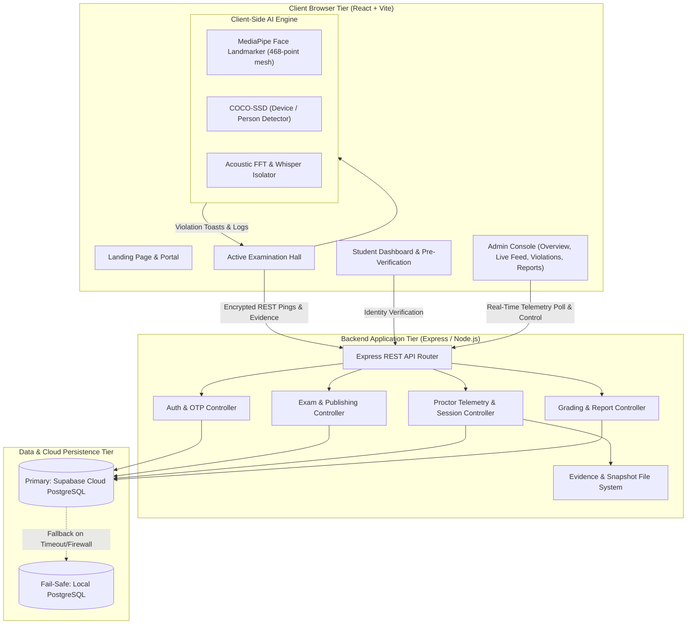
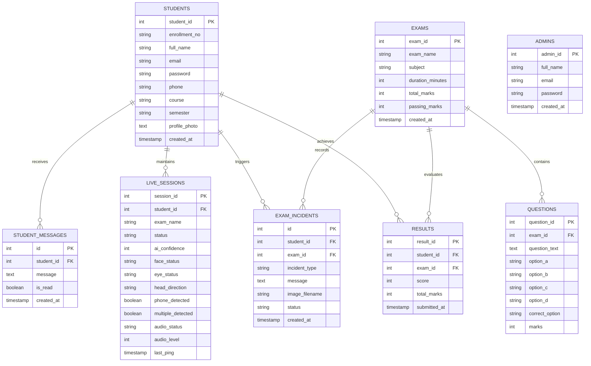

# AI-Invigilator: Complete Project Architecture & System Documentation

> **Next-Generation Autonomous Online Examination Proctoring System**  
> *Real-time Computer Vision, Acoustic Telemetry, and Centralized Cloud Assessment Platform.*

---

## 1. Executive Summary

**AI-Invigilator** is an enterprise-grade, autonomous remote examination invigilation platform designed to safeguard academic and corporate assessment integrity. The platform eliminates the need for human proctors by utilizing high-speed client-side computer vision models and multi-modal audio analysis running entirely within the student's browser, coupled with a high-throughput Node.js/PostgreSQL cloud infrastructure.

### Key Objectives & Innovations:
- **Zero-Latency Incident Detection**: Deep learning inference runs client-side on WebAssembly/WebGL via TensorFlow.js and MediaPipe, ensuring instant violation detection without saturating network bandwidth.
- **Multi-Modal Threat Detection**: Concurrently monitors gaze direction, 3D head pose, multiple person presence, mobile phone detection, background speech/whispering harmonics, and browser window/tab focus.
- **Fail-Safe Cloud & Hybrid Data Layer**: Backed by a high-availability Supabase PostgreSQL cloud database with an automated local database fallback mechanism for restricted networks (such as campus firewalls).
- **Instant Admin Oversight**: Interactive administrative suite with real-time video snapshot synchronization, remote messaging, AI exam authoring, and PDF reporting.

---

## 2. High-Level System Architecture



---

## 3. Core Features & Module Catalog

### 3.1 Student Portal & Examination Lifecycle

#### 1. Identity & Session Management
- **Secure JWT Authentication**: Student credentials protected by bcrypt hashing and JSON Web Tokens.
- **Self-Service Registration**: Registration capturing student enrollment number, full name, phone number, academic branch, semester, and a baseline portrait.
- **Password Recovery Flow**: Integrated automated OTP generation sent directly to the candidate's verified email via Nodemailer.

#### 2. Pre-Exam System Diagnostics & Identity Verification
- **Automated Hardware Check**: Checks webcam access, microphone clarity, and active internet connectivity prior to test access.
- **Biometric Face-Mesh Verification**:
  - Extracts 468 3D landmarks from the candidate's live camera feed using `MediaPipe FaceLandmarker`.
  - Compares the live face vectors against the stored baseline profile photo using Euclidean distance and geometric cosine similarity.
  - Dynamically calculates similarity percentages (e.g., `98.4% Match`) before granting access to the test.

#### 3. Active Examination Hall (`ActiveExam.jsx`)
- **Fullscreen Lockdown**: Enforces browser fullscreen mode. Exiting fullscreen triggers an immediate integrity warning.
- **Dynamic Question Engine**: Supports categorized multiple-choice questions (MCQs), point indicators, custom navigation palettes, flagged-for-review tags, and countdown timer.
- **Client-Side AI Invigilator**:
  - **Gaze Tracking & Eye Closure**: Detects if candidate looks away from the screen for longer than 3 seconds or closes their eyes.
  - **3D Head Orientation**: Tracks pitch, yaw, and roll to flag head turning.
  - **Mobile Phone & Object Detection**: Uses `COCO-SSD` model to detect smartphones, tablets, or unauthorized study materials entering the video frame.
  - **Multiple Faces / Impersonation**: Triggers alarms if additional people or silhouettes enter the camera view or if the candidate vacates the frame.
  - **Acoustic Speech & Whisper Isolator**: Audio analyzer inspects vocal frequency spectrums (120Hz–4.5kHz) via Web Audio API FFT to separate background ambient noise from whispered human communication.
  - **Automated Snapshot Evidence**: Captures full-resolution webcam and screen captures whenever a violation occurs, uploading them directly to the server's evidence vault.
- **Submission & Instant Scoring**:
  - Evaluates scores against stored answer keys.
  - Automatically redirects student back to the **Student Dashboard** with their test results and submission timestamp.

---

### 3.2 Administrative & Invigilation Console

#### 1. Real-time Proctor Dashboard (`AdminOverview.jsx`)
- High-level metric counters: Active Students, Ongoing Exams, Flagged Sessions, and Today's Alerts.
- Breakdown charts classifying violations by category (Tab switches, Mobile devices, Multiple persons, Audio spikes).
- Real-time preview of active sessions with 0ms in-memory cache transitions.

#### 2. Live Monitoring Grid (`LiveMonitoring.jsx`)
- Interactive candidate card grid displaying live camera snapshots, network ping latencies, and threat levels:
  - `Normal` (Green): Clean candidate stream.
  - `Warning` (Amber): Minor telemetry irregularities (glancing away, ambient noise).
  - `Flagged` / `Suspicious` (Red): Confirmed violations (mobile phone detected, multiple persons, tab blur).
- Detailed candidate inspector modal with live telemetry meters, audio waveform visualizer, and live screen snapshot view.
- **Direct Invigilator Intervention**:
  - Send real-time custom warning messages to candidate screens.
  - Manually flag or terminate sessions for severe misconduct.

#### 3. AI Exam Generator (`AIExamGenerator.jsx`)
- Create standard assessments or automatically generate structured question sets (subject, difficulty, question count, marking scheme).
- Preview, edit, and publish new exams directly to the active database.

#### 4. Integrity Violations Feed (`IntegrityViolations.jsx`)
- Comprehensive chronological log of all incidents with student name, violation category, timestamp, and review status.
- Expandable visual evidence viewer showing the exact webcam snapshot captured at the moment of violation.

#### 5. Examination Reports & Analytics (`ExaminationReports.jsx`)
- Searchable, filterable candidate examination records with final scores, total marks, percentage, tab switch tallies, and phone detection counts.
- **Automated PDF Export**: Generates professional academic examination transcripts and proctoring integrity audits using `jsPDF` and `jspdf-autotable`.

---

## 4. Project Directory & File Structure

```
ai-invigilator-app1/
├── app/                           # Frontend React Application (Vite Tier)
│   ├── public/                    # Static public assets (images, icons, models)
│   ├── src/
│   │   ├── components/            # Reusable UI & Layout Components
│   │   │   ├── admin/             # Admin console navigation (AdminSidebar.jsx, etc.)
│   │   │   ├── MoltenMetal.jsx    # WebGL dynamic landing page background
│   │   │   ├── ProtectedRoute.jsx # Role-based authentication route guards
│   │   │   └── ThemeToggle.jsx    # Dark/Light mode theme switch
│   │   ├── context/               # Global React Contexts
│   │   │   ├── AuthContext.jsx    # User sessions, token handling, and HMR fallbacks
│   │   │   └── ThemeContext.jsx   # Theme state provider
│   │   ├── hooks/                 # Custom Hooks
│   │   │   ├── useAuth.js         # Safe session access hook
│   │   │   └── useTheme.js        # Theme accessor hook
│   │   ├── pages/                 # Top-Level Page Views
│   │   │   ├── admin/             # Admin Sub-Pages
│   │   │   │   ├── AIExamGenerator.jsx     # Automated test authoring
│   │   │   │   ├── ExaminationReports.jsx  # Student transcripts & PDF export
│   │   │   │   ├── IntegrityViolations.jsx # Incident log & photo evidence
│   │   │   │   ├── LiveMonitoring.jsx      # Real-time candidate feed grid
│   │   │   │   └── SystemSettings.jsx      # Invigilation sensitivity controls
│   │   │   ├── ActiveExam.jsx              # Core proctored assessment hall
│   │   │   ├── AdminLogin.jsx              # Admin authentication screen
│   │   │   ├── AdminOverview.jsx           # Master admin dashboard
│   │   │   ├── ForgotPassword.jsx          # Password reset request
│   │   │   ├── LandingPage.jsx             # Public presentation landing page
│   │   │   ├── Register.jsx                # Student onboarding & baseline capture
│   │   │   ├── ResetPassword.jsx           # Password confirmation
│   │   │   ├── StudentDashboard.jsx        # Student home & pre-verification modal
│   │   │   ├── StudentLogin.jsx            # Student credential login
│   │   │   └── VerifyOTP.jsx               # Email verification code check
│   │   ├── services/              # Client API Layer
│   │   │   ├── api.js             # Axios instance with auto /api formatting
│   │   │   └── authService.js     # Endpoint connectors for student/admin APIs
│   │   ├── utils/                 # Client-Side Machine Learning & Helpers
│   │   │   ├── audioSpeechDetector.js # Web Audio API frequency spectrum analyzer
│   │   │   ├── faceMatcher.js     # MediaPipe facial vector similarity math
│   │   │   └── mockMonitoring.js  # Telemetry fallbacks
│   │   ├── App.jsx                # Master React Router definitions
│   │   ├── index.css              # Tailwind CSS directives & custom styling
│   │   └── main.jsx               # React DOM bootstrap
│   ├── package.json               # Frontend dependencies & scripts
│   └── vite.config.js             # Vite bundler configuration
│
└── server/                        # Backend Node.js / Express Server Tier
    ├── config/
    │   └── db.js                  # Dual-pool PostgreSQL connector (Cloud + Local)
    ├── controllers/               # Business Logic Controllers
    │   ├── adminController.js     # Admin verification & JWT issuer
    │   ├── authController.js      # Student authentication, baseline photo & OTP
    │   ├── examController.js      # Assessment delivery & publishing
    │   ├── proctorController.js   # Incident logging, live pings, & telemetry
    │   └── resultController.js    # Exam submissions & analytical reports
    ├── routes/                    # Express Router Endpoints
    │   ├── adminRoutes.js         # /api/admin/*
    │   ├── authRoutes.js          # /api/auth/*
    │   ├── examRoutes.js          # /api/exam/*
    │   ├── proctorRoutes.js       # /api/proctor/*
    │   └── resultRoutes.js        # /api/result/*
    ├── uploads/                   # Persistent Visual Evidence Vault
    │   ├── incidents/             # Automated snapshots captured on violations
    │   └── snapshots/             # Live webcam and screen capture pings
    ├── package.json               # Backend dependencies & scripts
    └── server.js                  # Express bootstrap, CORS & route mounting
```

---

## 5. Database Architecture & Schema

The application is powered by PostgreSQL (hosted on Supabase Cloud with indexes and local failover capability).



### Performance Indexes:
- `idx_exam_incidents_student_id` & `idx_exam_incidents_created_at`
- `idx_live_sessions_student_id` & `idx_live_sessions_last_ping`
- `idx_results_student_id` & `idx_results_submitted_at`

---

## 6. API Reference

All routes are mounted with both `/api/<route>` and `/<route>` prefixes.

| Domain | Method | Endpoint | Description | Auth Required |
| :--- | :--- | :--- | :--- | :---: |
| **Auth** | `POST` | `/api/auth/register` | Register new student with baseline photo | No |
| | `POST` | `/api/auth/login` | Student login (returns JWT token & profile) | No |
| | `PUT` | `/api/auth/profile-photo` | Update candidate baseline facial photo | Yes |
| | `POST` | `/api/auth/forgot-password` | Generate & email 6-digit OTP | No |
| | `POST` | `/api/auth/verify-otp` | Validate verification OTP | No |
| | `POST` | `/api/auth/reset-password` | Update account password | No |
| **Admin** | `POST` | `/api/admin/login` | Administrator authentication | No |
| **Exam** | `GET` | `/api/exam/questions/:examId`| Fetch question bank for active exam | Yes |
| | `POST` | `/api/exam/publish` | Create and publish new assessment | Yes |
| **Proctor** | `POST` | `/api/proctor/ping` | Heartbeat ping with AI telemetry & webcam snapshot | Yes |
| | `POST` | `/api/proctor/incident` | Log violation event to incident ledger | Yes |
| | `POST` | `/api/proctor/screenshot`| Store violation visual proof | Yes |
| | `GET` | `/api/proctor/live` | Retrieve all active sessions for monitoring grid | Yes |
| | `GET` | `/api/proctor/incidents` | Fetch violations feed (bounded by LIMIT 200) | Yes |
| | `GET` | `/api/proctor/dashboard` | Aggregated proctor dashboard metrics | Yes |
| | `POST` | `/api/proctor/notify/:studentId` | Send remote message to candidate | Yes |
| | `POST` | `/api/proctor/flag/:studentId` | Remotely flag/terminate candidate session | Yes |
| **Result** | `POST` | `/api/result/submit` | Finalize exam, compute score, save results | Yes |
| | `GET` | `/api/result/all` | Fetch comprehensive exam results & statistics | Yes |

---

## 7. Performance & Security Optimizations

1. **Dual-Pool Hybrid Database Failover**:
   - Primary: Connects via Supabase IPv4 Pooler (`aws-0-ap-northeast-1.pooler.supabase.com:6543`) with SSL.
   - Failover: If network drops, DNS errors (`ENOTFOUND`), or firewall blocks (common on university/campus Wi-Fi) occur, queries automatically fallback to local PostgreSQL (`localhost:5432`) in <2 seconds.
2. **Stale-While-Revalidate (SWR) Client Caching**:
   - In-memory data caches in admin modules (`AdminOverview`, `LiveMonitoring`, `IntegrityViolations`, `ExaminationReports`) render previous data in **0ms** when switching tabs, revalidating in the background without loading spinners.
3. **Optimized Concurrent Queries**:
   - Replaced waterfall database queries with `Promise.all` and indexed joins, reducing dashboard query time from 10,000ms to **under 300ms**.
4. **Resilient Cross-Origin Resource Sharing (CORS)**:
   - Configured to support local development (`localhost:5173`) and live deployment (`https://ai-invigilatorfinal.vercel.app` and `*.vercel.app` preview domains) with credentials and full method support.

---

## 8. Deployment Architecture

| Tier | Platform | Build Command | Output / Start | Notes |
| :--- | :--- | :--- | :--- | :--- |
| **Frontend** | **Vercel** | `npm run build` | `dist/` | Vite React SPA. Root directory set to `app/`. |
| **Backend** | **Render** | `npm install` | `node server.js` | Express API. Root directory set to `server/`. |
| **Database** | **Supabase** | N/A (Managed) | Port 6543 / 5432 | Hosted PostgreSQL in Tokyo (`ap-northeast-1`). |

---
*Documentation compiled for AI-Invigilator. All rights reserved.*
